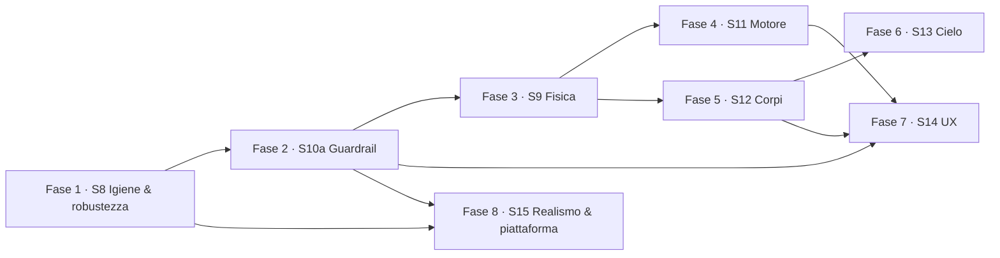

# 🗺️ Roadmap — Miglioramenti e nuove funzionalità (S8–S15)

> Piano di implementazione derivato dall'analisi del codebase e della
> documentazione (`README.md`, `docs/FEATURES.md`, `docs/MOBILE-UX.md`,
> `docs/UI-UX-REVIEW.md`). Ogni step è un **PR autonomo** con verifiche
> complete per evitare regressioni.
>
> Legenda impatto: 🔴 alto · 🟠 medio · 🟡 basso
> Effort: S ≤ ½g · M 1g · L 1–2g · XL > 2g
>
> Convenzioni di questo file:
> - **ID**: `M1` (miglioramento) · `F1` (feature) · `R1` (roadmap posticipata).
> - **PR title**: `type(scope): summary` (vedi `AGENTS.md`).
> - Tutti i comandi di verifica sono quelli usati da `AGENTS.md` e da
>   `.github/workflows/ci.yml`.

---

## ✅ Stato di implementazione (aggiornato al 2026-10-12)

Progresso complessivo: **24/25 step completati** · suite test: **298/298** (baseline 180) · lint 0 errori · 0 errori console in build.
Commit di riferimento: `5cbbdff` (Fasi 1–5 + F3 math) e working tree corrente (F3 UI + Fasi 7–8.2).

| Fase | Sprint | Step | Stato |
|---|---|---|---|
| 1 · Igiene & robustezza | S8 | 1.1 M2 · 1.2 M1 · 1.3 M8 · 1.4 M5 | ✅ Completata |
| 2 · Guardrail & perf | S10a | 2.1 M6a · 2.2 M6b · 2.3 M6c · 2.4 M6d · 2.5 M4 | ✅ Completata |
| 3 · Fisica | S9 | 3.1 M3 · 3.2 M9 | ✅ Completata |
| 4 · Funzionalità motore | S11 | 4.1 F1 · 4.2 F2 | ✅ Completata |
| 5 · Nuovi corpi | S12 | 5.1 F5 · 5.2 F4 | ✅ Completata |
| 6 · Cielo da Terra | S13 | 6.1 F3 (math **e** UI `SkyViewModal`) | ✅ Completata |
| 7 · Educazione & UX | S14 | 7.1 F7 · 7.2 F8 · 7.3 F11 · 7.4 F10 · 7.5 F9 | ✅ Completata |
| 8 · Realismo & piattaforma | S15 | 8.1 R1 ✅ · 8.2 R2 ✅ · 8.3 M7 ✅ · 8.4 R3 ⏳ | 🔄 3/4 |

### Dettaglio per step

- ✅ **1.1 M2** — `Planet.tsx`, `Planet.test.tsx`, `utils/textures.ts`, `utils/textures.test.ts` rimossi; `FEATURES.md` aggiornato (fallback DOM dichiarato storico).
- ✅ **1.2 M1** — `SceneErrorBoundary.tsx` (class component + retry via key) attorno a `<Suspense>` in `App.tsx`; `ContextLostGuard.tsx` dentro `<Canvas>` con overlay in portale. 10 test.
- ✅ **1.3 M8** — token `--text-secondary` (0.78) e `--text-muted` (0.62) in `index.css`; sweep `text-white/40→65`, `/50→70`, `/60→75` su 8 componenti.
- ✅ **1.4 M5** — `scripts/inject-sw-version.mjs` via hook npm `postbuild` (non in catena `&&`: su Windows la scrittura in catena non era affidabile). Sanity-check sulla `const CACHE_NAME` aggiornata.
- ✅ **2.1 M6a** — `src/a11y/axe.test.tsx` con `jest-axe`; regole escluse con motivazione in `src/a11y/axe.ts` (`color-contrast` non computabile in jsdom, coperta da Lighthouse; `region`; `heading-order`). Fix a11y reali: `aria-label` sullo slider Timeline, `role="status"` sul fallback Suspense.
- ✅ **2.2 M6b** — `scripts/check-bundle.mjs` + `bundle.config.mjs` (soglie: main 25KB gz, SolarScene 15KB, drei 180KB, three 200KB, totale 420KB); step `Check bundle budget` in `ci.yml`.
- ✅ **2.3 M6c** — `e2e/smoke.spec.ts` + `playwright.config.ts` (5 viewport) + workflow `e2e.yml`; `@playwright/test` come devDependency con deroga documentata in `AGENTS.md`; output Playwright in `.gitignore`.
- ✅ **2.4 M6d** — `.lighthouserc.json` + workflow settimanale `lighthouse.yml` (assert `warn` su a11y ≥ 0.9, best-practices ≥ 0.9, perf ≥ 0.6).
- ✅ **2.5 M4** — `utils/qualityTiers.ts` (funzione pura `nextTier` con isteresi/cooldown/floor) + `PerformanceGovernor.tsx` (default **OFF**, prop `enabled`); 8 test.
- ✅ **3.1 M3** — `orbitalInclination` J2000 per gli 8 pianeti; `angleToOrbitPosition` esteso (ordine i→Ω); Ω/i propagati a Bodies, Orbits, Moons, SaturnRings, PlanetRings, Conjunctions. 8 test in `scene/bodies3d.test.ts`.
- ✅ **3.2 M9** — `heliocentricVector3D` + `angularSeparation3D`; `Conjunctions.tsx` usa la separazione 3D. 6 test.
- ✅ **4.1 F1** — `utils/deepLink.ts` (parse/encode/writer debounced 300ms con `replaceState`); boot one-shot da `location.hash` in `App.tsx` (precedenza sull'hash, nessuna scrittura in prefs). 13 test.
- ✅ **4.2 F2** — `utils/celestialEvents.ts` (findConjunctions con minimi locali + raffinamento aureo; findOppositions) + `EventsModal.tsx` (lazy) + chip "☄ Eventi". 9 test. **Limite documentato**: il modello è decorativo, le date reali non corrispondono alle effemeridi (vedi §Deviazioni).
- ✅ **5.1 F5** — `scene/TrojanSwarm.tsx` (cluster L4/L5 co-rotanti con Giove, 80/40 punti desktop/mobile); montati in `SolarScene` quando `realistic`. 5 test.
- ✅ **5.2 F4** — `dwarfPlanets` (Plutone, Cerere) in `data/planets.ts` **fuori** da `simDate`/PPCM (array separato, test lo verifica); `scene/DwarfBodies.tsx`; 3 test di validazione.
- ✅ **6.1 F3** — math: `utils/skyView.ts` (GMST Meeus, triangolo astronomico, `sunAltitude`, `computeSkyView` in AU lineari da `meanLongitudeAt`); UI: `components/SkyViewModal.tsx` (SVG planetario, proiezione azimutale, 4 preset città + input manuale, chip "🌍 Cielo"). 10 test math + 5 test UI. **Fix in itinere**: la prima matrice di rotazione alt/az era sbagliata → riscritta con la formula standard del triangolo astronomico, verificata su mezzogiorno/alba all'equinozio (vedi §Deviazioni).
- ✅ **7.1 F7** — `hooks/useNarration.ts` (feature-detect, voce it-IT, cancel su cambio testo/unmount, flag `narrationActive` nello store zustand `store/ui.ts`); bottone 🔊 nel pannello info + tasto `N`; ducking in `AmbientAudio` (rampa a 0.02 durante la narrazione). 5 test.
- ✅ **7.2 F8** — `QuizModal`: livelli easy/medium/hard (3/5/8 domande), best score persistito per livello (`PREFS_KEYS.quizBest`, salvataggio in `useEffect`, StrictMode-safe), `focusPlanet` (bottone "🧠 Mettimi alla prova" nel tab Curiosità del pannello info → App `quizFocus`).
- ✅ **7.3 F11** — `gravity` nel dataset (8 pianeti, validati ±5%); `utils/logScale.ts` + `meanOrbitalVelocity` (derivata 29.78/√a); CompareModal con barre animate log-scale e nuove righe (Gravità, Vel. orbitale media). 8 test.
- ✅ **7.4 F10** — `MissionEntry { name, year, note? }` al posto di `string[]` per tutti gli 8 pianeti (35 missioni datate); helper `formatMission()`; tab Missioni come timeline verticale; validazione anni 1950–2035 ordinati.
- ✅ **7.5 F9** — `components/CommandPalette.tsx` (filtro, ↑↓, Enter, Esc, a11y combobox/listbox); import **sincrono** (non lazy, vedi §Deviazioni); Ctrl/Cmd+K in `App.tsx` (effect separato con setter funzionale); 17 comandi (8 pianeti, Oggi, Pausa, 4 viste, Screenshot, Tour, Free cam, 6 toggle); i test esistenti di tastiera non confliggono (gli input di testo sono già ignorati dal gestore globale). 8 test palette + 4 test keyboard App.
- ✅ **8.1 R1** — `LensFlare` di `@react-three/postprocessing@3.2.0` nel composer esistente (`src/scene/PostProcessing.tsx`), **`multisampling={0}` invariato**. Config: `lensPosition=[0,0,0]` (Sole all'origine), `opacity=0.45`, `glareSize=0.3`, `starBurst=false` (costo), ghost secondari ON. Occlusione via raycast del wrapper (i pianeti davanti al Sole attenuano il flare). FX-gated: default desktop ON / mobile OFF, quindi il costo del raycast per frame non tocca il default mobile. **Verifica reale in browser headless** (procedura FEATURES.md S5): campionamento 64×64 del drawing buffer per 60 frame → **0/60 frame neri**, 0 errori console, banner/simboli corretti. Docs aggiornate (`MOBILE-UX.md` §4.6 + §Rimandati).
- ✅ **8.2 R2** — pipeline texture tier-based:
  - **Asset reali scaricati**: Terra albedo **4096×2048** (`public/textures/planets/4k/earth.jpg`, NASA Blue Marble via repo three.js/jsdelivr) + **normal map 2K** (`normal/earth_normal_2048.jpg`) — Solar System Scope blocca il download diretto (403), quindi per la Terra si usa il mirror three.js (MIT/dati NASA)
  - **Normal map applicata** solo alla Terra in `Bodies.tsx` (`normalScale` 0.6, anisotropy max, colorSpace lineare preservato)
  - **Architettura upgrade automatico**: `scripts/generate-texture-manifest.mjs` (hook npm `prebuild`) scandisce `public/textures/planets/4k/` e genera `src/generated/hiResTextures.json`; `textureUrl(name, hiRes)` in `bodies3d.ts` usa il manifest con **fallback 2K garantito** (mai URL inesistenti). Chi deposita i 4K SSS (CC-BY) per Marte/Giove/Saturno ottiene l'upgrade senza toccare codice
  - **Tier**: `Bodies` riceve `hiRes={!mobile}` da `SolarScene`; mobile sempre 2K (fill-rate)
  - **PWA**: le 4K NON sono nell'`APP_SHELL` di `sw.js` (verificato) — solo cache on-demand runtime
  - `useTexture.preload` NON necessario: `useTexture` carica già tutto al mount (deviazione §12)
  - Verifica in browser: richiesta `/textures/planets/4k/earth.jpg` → 200, normal map → 200, 0 errori console. 6 test nuovi (`textureUrl` + normal map). Crediti aggiornati in `public/textures/README.md`
- ✅ **8.3 M7** — i18n it/en layer leggero:
  - **Dizionari**: `src/i18n/dict.ts` con **~120 chiavi** (`chip.*`, `tip.*`, `sidebar.*`, `panel.*`, `compare.*`, `quiz.*`, `events.*`, `sky.*`, `banner.*`, `palette.*`, `cmd.*`, `onboarding.*`); le stringhe `it` sono **identiche** a quelle hardcoded → la suite esistente continua a passare con locale di default.
  - **Layer runtime**: `src/i18n/index.ts` esporta `t(key, vars?)` (imperativo), `useT()` (hook reattivo con `useCallback` per memo), `getLocale()`, `toggleLocale()`, `localeTag()`. Store zustand con persistenza in `localStorage` (`PREFS_KEYS.lang`, default `'it'`). Interpolazione `{var}` con `split/join` (compatibile lib ES2020).
  - **Chip lingua** `🌐 EN` / `🌐 IT` in header (toggle one-click, persistito). Default `it` (l'app si avvia in italiano).
  - **Migrazione shell** (V1 del piano): header chips, tooltip, FAB mobile "Controlli/Chiudi", `ControlsSidebar` (incluso `toLocaleDateString(localeTag())`), `PlanetInfoPanel` (tab Dati/Atmosfera/Missioni/Curiosità, "Nessuna missione registrata.", "Mettimi alla prova", narration labels), `ConjunctionBanner`, `CompareModal`, `QuizModal` (livelli, focus, best score, fine), `EventsModal` (incluso `eventLabel` parametrico con `t`), `SkyViewModal` (incluso cardinali N/E/S/W), `CommandPalette` (placeholder/aria/none), `OnboardingTip`. `App.tsx` ha anche `useT()` + chip toggle iniettato.
  - **Non migrato** (V2): facts dataset, domande quiz generate, nomi pianeti (`nameIt`), label metriche `moons`/`gravity` restano in italiano per non rompere i test e la coerenza del dataset.
  - **Verifica end-to-end** in browser headless: chip `🌐 EN` presente, click → header passa a `Labels/Realism/Eclipses`, click di nuovo → torna `Etichette/Realismo/Eclissi`, 0 errori console. Persistenza `localStorage` confermata da `toggleLocale` test.
  - **Test**: 11 nuovi (`src/i18n/dict.test.ts`): parità chiavi it/en, placeholder coerenti, fallback, `t()` con vars, `setLocale`, `toggleLocale` (con persistenza), `localeTag`, `useT` reattivo.

### Deviazioni e decisioni tecniche registrate in itinere

1. **Modelli kepleriano "decorativo"** — `simTimeForDate` mappa le date su un tempo di simulazione ideato (posizioni J2000 = offset arbitrari), quindi **le date del calendario non corrispondono a effemeridi reali**. Conseguenze:
   - il test "Grande Congiunzione 2020-12-21" è stato sostituito da assert strutturali (eventi trovati, ordinati, sep coerenti);
   - `EventsModal` mostra il disclaimer "precisione ~±1° sulle date".
   Per effemeridi reali servirebbe l'elemento-set completo (a, e, i, Ω, ω, M₀) + equazione di Keplero con epoca: apribile come fase 2.
2. **`altitudeAzimuth` riscritta** — la prima versione (catena di rotazioni matriciali) restituiva azimut specchiato; sostituita con la soluzione trigonometrica del triangolo astronomico (`az = atan2(−cosδ·sinH, sinδ·cosφ − cosδ·sinφ·cosH)`), verificata su 3 casi esatti. I test costruiscono le date con il **rate sidereo** (1.0027379), non solare.
3. **`fileParallelism: false`** in `vitest.config.ts` — con >25 file il parallelismo fra thread generava timeout flaky su macchina lenta; il costo (~+30s in CI) compra la determinabilità.
4. **`CACHE_NAME` via hook `postbuild`** — la catena `vite build && node script` su Windows/PowerShell scriveva prima che il file fosse leggibile; l'hook npm postbuild è affidabile. Lo script gestisce tutte le occorrenze del placeholder (regex globale) e fallisce se la `const` non è aggiornata.
5. **Command palette sincrona** — l'import lazy rompeva i test con fake timer (la risoluzione della promise non avviene nel flusso sincrono di `fireEvent`); il componente è piccolo e keyboard-first, quindi import diretto.
6. **FPS governor default OFF** — per evitare qualsiasi cambiamento percettibile del comportamento attuale finché non esiste un chip UI per attivarlo (il piano prevedeva l'attivazione con query param `?qualityHud=1`; la logica è pronta e testata).
7. **Axe**: 3 regole disabilitate con motivazione documentata in `src/a11y/axe.ts`; 2 violazioni reali corrette (aria-label slider, role="status" sul fallback Suspense).
8. **`EventsModal` lazy** richiede export default (wrapper `then((m) => ({ default: m.EventsModal }))`).

### Deviazioni aggiuntive (batch 8.1)

9. **Corruzione encoding in `src/data/planets.ts` individuata e corretta** — un round-trip PowerShell (`Get-Content`/`Set-Content`, PS 5.1 legge UTF-8 senza BOM come CP1252) aveva double-encoded 65 caratteri (ù→ù, è→è, '→’, ≈→≈…) + aggiunto BOM. Corrotti anche i simboli dei pianeti, visibili nel banner congiunzioni ("♀"→"♀"). **Fix**: reverse-transcode esatto (stringa UTF-8 → byte CP1252 → UTF-8, senza BOM), verificato: 0 mojibake residui, dataset test 88/88, bundle pulito, banner "♀ Venere ↔ ♆ Nettuno" corretto in browser. **Lezione**: su Windows/PS 5.1 usare l'edit tool o `[System.IO.File]::ReadAllText/WriteAllText` con encoding esplicito, mai `Get-Content`/`Set-Content` per file non-ASCII.
10. **Deep-link data completato per davvero** — il ramo `parsed.date` di `App.tsx` era uno stub (calcolava `simTimeForDate` senza usarlo): ora fa `setSimDate(new Date(parsed.date))`, sfruttando i memo dichiarativi `anglesForDate`/`anomaliesForDate`/`simTimeForDate` già esistenti (stesso percorso del date picker). Un link `#p=Mars&d=2025-01-16` ora funziona end-to-end.
11. **Debito lint saldato** — 22 errori `no-unused-vars` accumulati negli step 3.2–8.1 (mascherati dall'output troncato `Select-Object -Last 5`) rimossi: import morti in `Conjunctions.tsx`/`DwarfBodies.tsx`/`celestialEvents.ts`/`skyView.ts`/`celestialEvents.test.ts`, stub `daysFromJ2000`, helper legacy `angDiff`. Stato: **0 errori, 11 warning pre-esistenti**.
12. **Texture 4K: fonte CDN (non repo) + manifest a build** — Solar System Scope risponde 403 ai download diretti, quindi gli albedo 4K di Marte/Giove/Saturno NON sono committabili in modo automatico. Scelta: Terra 4K + normal map committate (mirror three.js), e **manifest generato dall'hook `prebuild`** che attiva automaticamente qualunque 4K depositato in `public/textures/planets/4k/` — così l'upgrade per gli altri pianeti è un'operazione di soli asset, senza tocchi di codice. `resolveJsonModule` aggiunto a `tsconfig.json` per l'import del manifest.
13. **`useTexture.preload` non implementato** — il piano lo prevedeva per la Terra 4K su desktop, ma `useTexture` di drei carica già tutte le texture al mount di `<Bodies>`: un preload aggiuntivo sarebbe un no-op. L'ottimizzazione futuro-friendly sarebbe il lazy-load su zoom (fly-to), non richiesto dal piano.
14. **i18n V1: shell UI, no facts/domande** — il piano limitava la V1 a header/sidebar/modali/banner. La migrazione è completa per quelle superfici; i facts del dataset, le domande generate del quiz e i nomi pianeti (`nameIt`) restano in italiano (la sostituzione con un `nameEn` è V2). Rischio principale: una chiave dimenticata → guard in dev (warning console) + fallback a `it` + ritorno della chiave grezza, ma non un crash. `vite-env.d.ts` aggiunto per `import.meta.env`; `replaceAll` evitato in favore di `split/join` (lib ES2020).
15. **`OverflowMenu` in App.tsx** ha dovuto aggiungere `useT()` perché la `aria-label`/`title` del trigger button richiedono la traduzione (la `t` del componente parent non è in scope qui). Il componente `OverflowMenu` è definito nello stesso file di App e riceve l'hook direttamente.

---

## 0. Principi trasversali (valgono per OGNI step)

### 0.1 Checklist pre-commit / pre-PR (obbligatoria)
Comandi esatti, nell'ordine di `AGENTS.md`:

```bash
npm ci
npx prettier --check "src/**/*.{ts,tsx,css}" "*.json"
npm run lint
npm run typecheck
npm test
npm run build
```

Per i PR che toccano layout / mobile sheet / header / CSS / pannello info /
sidebar / service worker: in aggiunta, verifica Playwright multi-viewport
(vedi `AGENTS.md`).

### 0.2 Vincoli critici da NON violare (le regressioni storiche)
Questi bug, documentati in `docs/FEATURES.md` e `docs/UI-UX-REVIEW.md`, sono
riassunti qui come guardia — una PR che li reintroduce va rifiutata.

| Vincolo | Dove | Sintomo di violazione |
|---|---|---|
| `NO_ANOMALIES` a livello di modulo | `src/hooks/useOrbitEngine.ts` | Pianeti che "tornano indietro" ogni ~250ms |
| `EffectComposer multisampling={0}` | `src/scene/PostProcessing.tsx` | Frame neri a intermittenza con MSAA>0 |
| `EffectComposer` composer costruito una volta (no remount per FX) | `src/scene/PostProcessing.tsx` | Sfarfallio/FX non applicati |
| Sheet content sempre montato (`visibility`, non `display:none`) | `src/components/ControlsSidebar.tsx` | Lista pianeti esclusa da a11y |
| `user-scalable=no` + `viewport-fit=cover` | `index.html` | Pinch browser in conflitto con OrbitControls |
| Target touch ≥ 44px su `pointer:coarse` | `src/index.css` | Regressione WCAG 2.5.5 |
| `env(safe-area-inset-*)` su FAB/sheet/header | `src/index.css`, `index.html` | Notch/gesture bar coprono controlli |
| `gl.preserveDrawingBuffer = true` per screenshot mode | `src/scene/SolarScene.tsx` | Screenshot nero |
| `canvas.toDataURL` con Web Share API + fallback download | `src/App.tsx:318` | Perdita screenshot su mobile |
| `dpr` tier `[1, 1.25]` mobile / `[1, 1.75]` desktop | `src/scene/SolarScene.tsx` | Fill-rate saturo su smartphone |
| `belt counts` tier 200/70 mobile, 350/120 desktop | `SolarScene.tsx`, `AsteroidBelt3D`, `KuiperBelt3D` | FPS crollati |
| `eclipsesEnabled` default OFF | `App.tsx` | Costo GPU al primo avvio |
| `animationDuration` multipli di 0.2s per tutti i corpi animati | `src/data/planets.ts` commento | PPCM `simTimeForDate` non più esatto (perde coerenza data→sim) |
| Bump `CACHE_NAME` in `public/sw.js` ad ogni rilascio di asset | `public/sw.js:9` | PWA bloccata su asset vecchi |

### 0.3 Test di regressione esistenti da non rompere mai
- `src/orbit.motion.test.tsx` — asserisce moto monotono (anti-NO_ANOMALIES).
- `src/camera.flyto.regression.test.tsx` — fly-to imperativo.
- `src/App.keyboard.test.tsx` — scorciatoie tastiera esistenti.
- `src/App.flows.test.tsx` — flussi chip e selezione.
- `src/App.test.tsx` — smoke.
- `src/hooks/useOrbitEngine.test.ts` + `useOrbitEngine.stall.test.ts`.
- `src/utils/kepler.test.ts` + `simDate.test.ts` (coerenza data, PPCM esatto).
- `src/data/planets.validate.test.ts` (tolleranza 5% valori fisici).
- `src/utils/{format,random,textures}.test.ts`.
- `src/hooks/useMedia.test.tsx` + `useOrbitCounters.test.ts`.
- `src/scene/easing.test.ts`.
- Totale attuale: **180/180**. Target: non regredire, crescere a ≥ 200.

### 0.4 Convenzioni di PR (da `AGENTS.md`)
- Una modifica logica per PR.
- Titolo `type(scope): summary` (es. `feat(physics): add orbital inclination i`).
- Body: **bug → causa → fix → verifica** (tabella per check cross-viewport).
- Mai committare tooling dev-only non concordato (vedi sezione 6, "Aperture").

### 0.5 Policy di verifica
- PR con impatto visivo: rigenerare `docs/images/*.png` con
  `scripts/screenshots.mjs`.
- PR con impatto mobile: script Playwright in
  `/tmp/kilo/mobile-test.mjs` (citato in `AGENTS.md`) o equivalente ai
  viewport 393×852, 375×667, 768×1024, 1280×800, 1440×900.
- PR con impatto PWA: `CACHE_NAME` bumpato (lo script `inject-sw-version.mjs`
  introdotto nello step 1.4 lo fa automaticamente; le PR che aggiungono asset
  si limitano a verificare che il bump sia avvenuto).

---

## 1. Catalogo delle proposte (riepilogo da analisi)

| ID | Proposta | Tipo | Impatto | Effort | Dipendenze | Sprint |
|---|---|---|---|---|---|---|
| **M2** | Rimozione codice morto DOM (Planet.tsx + utils/textures.ts) | miglioria | 🟠 | S | — | S8 |
| **M1** | Error boundary WebGL + gestione context loss | miglioria | 🔴 | M | — | S8 |
| **M8** | Contrasto label WCAG AA (token + sweep `text-white/40..60`) | miglioria | 🟠 | S | — | S8 |
| **M5** | `CACHE_NAME` automatico da build hash | miglioria | 🟠 | S | — | S8 |
| **M6a** | axe-core in Vitest (App.a11y.test.tsx) | CI | 🟠 | S | — | S10a |
| **M6b** | Script `check-bundle.mjs` con soglie gzip | CI | 🟡 | S | — | S10a |
| **M6c** | E2E Playwright multi-viewport in CI (5 viewport) | CI | 🔴 | M | M6a | S10a |
| **M6d** | Lighthouse CI (a11y ≥ 0.9, perf ≥ 0.6 mobile) | CI | 🟡 | S | M6b | S10a |
| **M4** | FPS governor adattivo (dpr + drawRange) | miglioria | 🟠 | M | — | S10a |
| **M3** | Inclinazione orbitale `i` (dataset + transform 3D) | fisica | 🔴 | L | — | S9 |
| **M9** | Congiunzioni: separazione angolare 3D con `i`+`ω` | fisica | 🟠 | M | M3 | S9 |
| **F1** | Deep link (URL hash: pianeta, data, speed, toggle) | feature | 🟠 | M | — | S11 |
| **F2** | Pannello "Eventi celesti" (congiunzioni, opposizioni, transiti) | feature | 🔴 | M | M9 | S11 |
| **F5** | Troiani di Giove (L4/L5, `THREE.Points`) | feature | 🟡 | S/M | — | S12 |
| **F4** | Pianeti nani (Plutone, Cerere, + opzionali) | feature | 🟠 | M/L | M3 | S12 |
| **F3** | "Cielo da Terra" — planetario geocentrico | feature | 🔴 | L | M3 | S13 |
| **F7** | Narrazione TTS (Web Speech API) | feature | 🟠 | S/M | — | S14 |
| **F8** | Quiz evoluto (difficoltà, best score, "Mettimi alla prova") | feature | 🟠 | M | — | S14 |
| **F11** | Confronto arricchito (barre log-scale, gravità, vel. orbitale) | feature | 🟠 | M | — | S14 |
| **F10** | Timeline missioni interattiva (data strutturata) | feature | 🟠 | M | — | S14 |
| **F9** | Command palette (Ctrl/Cmd+K) | feature | 🟠 | M | — | S14 |
| **R1** | Lens flare via `@react-three/postprocessing` | roadmap | 🟠 | M | M5 | S15 |
| **R2** | Texture 4K + normal map (Earth/Mars/Jupiter/Saturn) | roadmap | 🟠 | M | M5 | S15 |
| **M7** | i18n it/en (layer leggero, default IT) | miglioria | 🟠 | L | — | S15 |
| **R3** | WebXR (spike, `@react-three/xr`) | roadmap | 🟡 | XL | M5, M4 | S15 (opzionale) |

Totale: **25 step**, organizzati in **8 sprint (S8–S15)**.

---

## 2. Dipendenze fra step



Legenda rapida: ogni step ha dipendenze solo dagli step a monte nella freccia
più eventuali dipendenze dirette indicate nella tabella §1 (es. F2 richiede
M9, F4 richiede M3, R1/R2/R3 richiedono M5).

---

## 3. Ordine di implementazione (e perché)

Ordine deciso su tre criteri:
1. **Rischio decrescente**: igiene/robustezza prima delle feature (un bug
   scoperto tardi costa di più).
2. **Guardrail prima del lavoro a largo raggio**: CI/a11y/budget/E2E
   catturano regressioni a basso costo, vanno in piedi prima di toccare
   dataset e motore.
3. **Fisica prima delle feature che la consumano**: inclinazione `i` e
   congiunzioni con `ω` abilitano eventi celesti, pianeti nani e cielo da
   Terra con precisione reale.

| # | Fase / Sprint | Step | Temi | Effort cum. |
|---|---|---|---|---|
| 1 | **Fase 1 · S8** Igiene & robustezza | 1.1–1.4 | M2, M1, M8, M5 | ~2g |
| 2 | **Fase 2 · S10a** Guardrail & perf | 2.1–2.5 | M6a, M6b, M6c, M6d, M4 | ~3–4g |
| 3 | **Fase 3 · S9** Fisica | 3.1–3.2 | M3, M9 | ~3g |
| 4 | **Fase 4 · S11** Funzionalità motore | 4.1–4.2 | F1, F2 | ~3g |
| 5 | **Fase 5 · S12** Nuovi corpi | 5.1–5.2 | F5, F4 | ~2–3g |
| 6 | **Fase 6 · S13** Cielo da Terra | 6.1 | F3 | ~2g |
| 7 | **Fase 7 · S14** Educazione & UX | 7.1–7.5 | F7, F8, F11, F10, F9 | ~4–5g |
| 8 | **Fase 8 · S15** Realismo & piattaforma | 8.1–8.4 | R1, R2, M7, R3 | ~5–6g |

Totale stimato: **~25–30 giornate** (su 8 sprint, a passo una PR al giorno).
Sprint 8 è l'unico dove si può aprire un branch parallelo su R3 (WebXR spike).

---

## 4. Dettaglio degli step

Per ogni step:
- **PR** (titolo suggerito)
- **Obiettivo**
- **File** (nuovi · modificati · rimossi)
- **Come** (punti tecnici non negoziabili)
- **Test** (nuovi)
- **Rischi & mitigazioni**
- **Verifica** (comandi + manuale)

---

### Step 1.1 · Rimozione codice morto DOM [M2] · 🟠 · S

**PR**: `chore(cleanup): remove unused DOM planet fallback and bump-map util`

**Obiettivo**: eliminare `src/components/Planet.tsx` e `src/utils/textures.ts`,
più i relativi test, che non sono più referenziati dal runtime (lo conferma
`rg "from.*utils/textures"` — unico match: `Planet.tsx:15`).

**File**:
- Rimossi: `src/components/Planet.tsx`, `src/components/Planet.test.tsx`,
  `src/utils/textures.ts`, `src/utils/textures.test.ts`.
- Modificati: `docs/FEATURES.md` (sezione "Saturno: anelli e ombre" e "Bump
  map procedurali" — descrivevano il fallback DOM rimosso nello sprint
  Three.js F15).

**Come**:
1. `rg "components/Planet|utils/textures"` deve restituire 0 match dopo la
   rimozione.
2. Aggiornare le due sezioni di `FEATURES.md` dichiarando che la fallback DOM
   non esiste più (decisione già documentata in `UI-UX-REVIEW.md` §10 ma mai
   riflessa in `FEATURES.md`).

**Test**: nessun nuovo test (rimozione netta). La suite deve restare 180/180.

**Rischi & mitigazioni**:
- **Rischio**: un consumer indiretto. **Mitigazione**: grep in pre-step;
  abortire se un match resta.
- **Rischio**: docs che citano il fallback. **Mitigazione**: aggiornare
  `FEATURES.md` nello stesso PR.

**Verifica**:
```bash
npm test                # 180/180
npm run typecheck       # 0 errori
rg "components/Planet|utils/textures" src   # 0 match
```

---

### Step 1.2 · Error boundary WebGL + context loss [M1] · 🔴 · M

**PR**: `feat(robustness): add WebGL error boundary and context-loss recovery`

**Obiettivo**: una `WebGL context lost` o un'eccezione dentro la scena
oggi lascia canvas vuoto (c'è solo `<Suspense>` in `App.tsx:559`).
Aggiungere: (a) un `ErrorBoundary` React che catturi eccezioni del Canvas;
(b) un listener `webglcontextlost` / `webglcontextrestored` con UI di retry.

**File**:
- Nuovi: `src/components/SceneErrorBoundary.tsx`,
  `src/scene/ContextLostGuard.tsx`.
- Modificati: `src/App.tsx` (wrap lazy `SolarScene` nel boundary), `SolarScene.tsx`
  (monta `ContextLostGuard`).

**Come**:
- `SceneErrorBoundary`: class component con `getDerivedStateFromError`,
  `componentDidCatch` (log in console, mai secrets); UI fallback = pannello
  `glass` con titolo "Scena non disponibile", testo, bottone "🔄 Riprova"
  che forza remount (`setState({ key: prev+1 })`) e uno "Ricarica pagina".
- NON sostituisce la `Suspense` di loading (restante); è **sopra** di essa.
- `ContextLostGuard`: dentro al Canvas, `useEffect` su `gl.domElement`:
  - `webglcontextlost` → `e.preventDefault()`, setta `lost: true` in uno
    store.
  - `webglcontextrestored` → reset.
  - Overlay DOM (portale) con messaggio + bottone "Riprova".
- Aggiungere `PREFS_KEYS.glState`? No: lo stato è **sessione**, non va
  persistito.

**Test**:
- `src/components/SceneErrorBoundary.test.tsx`: render con child che
  lancia, assert UI fallback; reset key → child rimontato.
- `src/scene/ContextLostGuard.test.tsx`: mock canvas con
  `dispatchEvent(new Event('webglcontextlost'))`, assert overlay.

**Rischi & mitigazioni**:
- **Rischio**: `preventDefault` non chiamato = il browser non tenta il
  restore. **Mitigazione**: assert in test.
- **Rischio**: double overlay (Suspense + boundary). **Mitigazione**: il
  boundary gestisce solo errori, non loading; UI mutuamente esclusiva.
- **Rischio**: eccezione nel guard stesso. **Mitigazione**: errori
  provenienti dal Canvas restano catturati dal boundary (che è sopra).

**Verifica**:
```bash
npm test                # 180 + 2 nuovi = 182
npm run build
# Manuale: forzare crash via DevTools → simulate WebGL context loss →
# atteso overlay + riprova funzionante.
```

---

### Step 1.3 · Contrasto label WCAG AA [M8] · 🟠 · S

**PR**: `fix(a11y): raise label contrast to WCAG AA on glass surfaces`

**Obiettivo**: token `--text-secondary: rgba(255,255,255,0.7)` e label
`text-white/40..60` sono al limite del rapporto 4.5:1 su vetro scuro
(segnalato in `UI-UX-REVIEW.md` §3.13.5, mai risolto).

**File**:
- Modificati: `src/index.css` (`--text-secondary` → `rgba(255,255,255,0.78)`,
  aggiungere `--text-muted: rgba(255,255,255,0.62)`), sweep classi Tailwind
  `text-white/4[0-6]` → `text-white/70+` (o nuove classi utility `.text-muted`).

**Come**:
1. Identificare tutti gli usi problematici: `rg "text-white/(4|5|6)0" src/`.
2. Sostituire con token semantici `--text-secondary` / `--text-muted`.
3. Aggiungere regola CSS `body` che imposta `color: var(--text-secondary)`.

**Test**:
- `src/a11y/contrast.test.ts`: parse `index.css`, asserisce che
  `--text-secondary` ≥ 0.75 alpha, `--text-muted` ≥ 0.6.
- (opzionale) `vitest-axe` su `ControlsSidebar`, `PlanetInfoPanel`,
  `CompareModal`, `QuizModal` — assenza di `color-contrast` violations.

**Rischi & mitigazioni**:
- **Rischio**: regressione visiva (testi più "pesanti"). **Mitigazione**:
  la modifica è voluta; le screenshot docs vanno rigenerate.

**Verifica**:
```bash
npx prettier --check "src/**/*.{ts,tsx,css}"
npm run lint
npm test
npm run build
# Mobile Playwright: conferma leggibilità a 375×667 e 393×852.
# Rigenerare docs/images/*.png (vedi §0.5).
```

---

### Step 1.4 · `CACHE_NAME` automatico da build [M5] · 🟠 · S

**PR**: `chore(pwa): auto-bump service worker CACHE_NAME from build hash`

**Obiettivo**: oggi `public/sw.js:9` ha `CACHE_NAME = 'solarsys-v3'` manuale;
l'`AGENTS.md` chiede di bumpare a mano ad ogni release. Automatizzare.

**File**:
- Nuovi: `scripts/inject-sw-version.mjs`.
- Modificati: `package.json` (`"build": "tsc --noEmit && vite build && node scripts/inject-sw-version.mjs"`),
  `public/sw.js` (sostituire `const CACHE_NAME = 'solarsys-v3'` con
  `const CACHE_NAME = 'solarsys-__BUILD_HASH__'`), `vercel.json` (nessuna
  modifica).

**Come**:
1. Lo script calcola l'hash dei file in `dist/assets/**` (sha256, primi 8
   caratteri) e riscrive `dist/sw.js` sostituendo il placeholder.
2. Aggiungere `"build:no-sw": "tsc --noEmit && vite build"` per debug.
3. Test: dopo build, `rg "CACHE_NAME = 'solarsys-" dist/sw.js` mostra un
   hash non-vuoto.

**Test**: smoke test in CI (lo step `build` del workflow verifica il
placeholder sostituito).

**Rischi & mitigazioni**:
- **Rischio**: `sw.js` viene letto prima dell'iniezione. **Mitigazione**:
  il placeholder esiste in `public/sw.js` (copiato in `dist/sw.js`),
  l'iniezione avviene dopo `vite build`; l'utente finale riceve sempre
  `dist/sw.js` con hash.
- **Rischio**: cache aggressive su PWA. **Mitigazione**: lo script di
  installazione del SW fa già `caches.delete(k !== CACHE_NAME)`.

**Verifica**:
```bash
npm run build
grep "CACHE_NAME" dist/sw.js   # deve contenere un hash
npm run preview &
# Manuale: DevTools → Application → Service Workers → Update; verificare
# nuova cache attiva.
```

---

### Step 2.1 · axe-core in Vitest [M6a] · 🟠 · S

**PR**: `test(a11y): add axe-core assertions to App smoke tests`

**Obiettivo**: rendere automatica la metrica "no regressioni a11y" già
presente come obiettivo in `MOBILE-UX.md` §5.

**File**:
- Nuovi: `src/a11y/axe.test.tsx`, `src/a11y/setup.ts` (config `jest-axe`
  ruleset: escludere `color-contrast` per ora, coperto da 1.3; lasciare
  attivi `landmark-*`, `aria-*`, `button-name`, `link-name`).
- Modificati: `package.json` (`devDependencies`: `axe-core`, `jest-axe`).

**Come**: render di `App` come in `App.test.tsx`, ma con `await axe(container)`.

**Test**: `App.a11y.test.tsx` con 3 scenari (sidebar aperta, planet info
aperta, modal quiz aperto) — assert `toHaveNoViolations()`.

**Rischi & mitigazioni**:
- **Rischio**: `color-contrast` flagga i problemi che 1.3 sta fixando.
  **Mitigazione**: escluderlo per ora; riattivarlo dopo il merge di 1.3.
- **Rischio**: jsdom limita alcuni controlli axe. **Mitigazione**:
  `axe-core` con `regionRules: { exclude: ['color-contrast'] }` + documentare
  l'esecuzione manuale via DevTools/Lighthouse (step 2.4) per la copertura
  reale.

**Verifica**:
```bash
npm test    # 180 + 3 nuovi = 183
```

---

### Step 2.2 · Budget bundle script [M6b] · 🟡 · S

**PR**: `chore(ci): add bundle-size budget check`

**Obiettivo**: nessun PR può aumentare silenziosamente la dimensione dei
chunk principali.

**File**:
- Nuovi: `scripts/check-bundle.mjs`, `bundle.config.mjs` (soglie).
- Modificati: `.github/workflows/ci.yml` (step dopo `build`).

**Come**:
1. Lo script legge `dist/assets/*.js`, gzip con `zlib.gzipSync`, somma per
   categoria (main, vendor-drei, vendor-three, SolarScene).
2. Soglie iniziali (riferimento: bundle S7 = main 16.04 KB gz, SolarScene
   10.35 KB gz, drei-vendor 161.51 KB gz):
   - main ≤ **25 KB** gz
   - SolarScene (chunk lazy) ≤ **15 KB** gz
   - drei-vendor ≤ **170 KB** gz
   - totale JS ≤ **320 KB** gz
3. Stampa tabella Markdown, esce con codice 1 se sforato.
4. CI: step `Check bundle budget` che chiama `node scripts/check-bundle.mjs`.

**Test**: nessun nuovo test (script).

**Rischi & mitigazioni**:
- **Rischio**: soglie fragili su deps minor. **Mitigazione**: fallimento
  `warn` con commento PR, non blocca fino a `error`; passare a `error` dopo
  2 sprint di calibrazione.

**Verifica**: workflow verde.

---

### Step 2.3 · E2E Playwright multi-viewport in CI [M6c] · 🔴 · M

**PR**: `test(e2e): add Playwright multi-viewport smoke spec`

**Obiettivo**: la procedura manuale in `AGENTS.md` (5 viewport, controlli
cross-device) diventa un gate automatico.

**File**:
- Nuovi: `e2e/smoke.spec.ts`, `playwright.config.ts`, `.github/workflows/e2e.yml`.
- Modificati: `package.json` (`devDependencies`: `@playwright/test`,
  script `"e2e": "playwright test"`, `"e2e:install": "playwright install chromium --with-deps"`),
  `AGENTS.md` (aggiornare la nota "non committare playwright" — vedi §6).

**Come**:
1. `playwright.config.ts`: `testDir: 'e2e'`, `retries: 1`, `use.baseURL: 'http://localhost:4173'`,
   `webServer: { command: 'npm run preview', port: 4173, reuseExistingServer: !process.env.CI }`,
   `projects` con i 5 viewport di `AGENTS.md`.
2. `smoke.spec.ts` con i controlli elencati in `AGENTS.md`:
   - `elementFromPoint` al centro viewport = `CANVAS` (non un wrapper)
   - FAB apre la controls sheet (mobile)
   - selezionare un pianeta apre il pannello info
   - il quiz si apre
   - nessun errore JS in `pageerror` / `console.error`
3. CI: workflow separato `e2e.yml` su `pull_request` (più lento del quality
   job, parallelo).

**Test**: lo spec stesso.

**Rischi & mitigazioni**:
- **Rischio**: flake (FPS rendering, animazioni). **Mitigazione**: `retries: 1`,
  attendere `waitForLoadState('networkidle')` + `await page.waitForFunction(() => window.__appReady)`.
  Aggiungere una flag `window.__appReady` esposta da `App` quando la scena
  è montata.
- **Rischio**: tempo CI. **Mitigazione**: solo `chromium`, `shard` per i 5
  viewport in parallelo, total target ≤ 4 min.
- **Rischio**: conflitti con `AGENTS.md`. **Mitigazione**: PR dedicata che
  aggiorna `AGENTS.md` (vedi §6).

**Verifica**:
```bash
npm run e2e:install    # una volta
npm run build
npm run e2e            # deve passare locale
# CI: workflow e2e verde su PR.
```

---

### Step 2.4 · Lighthouse CI [M6d] · 🟡 · S

**PR**: `ci(perf): add Lighthouse CI against preview build`

**Obiettivo**: misurare periodicamente a11y e perf reali sul bundle di
produzione.

**File**:
- Nuovi: `.lighthouserc.json`, `.github/workflows/lighthouse.yml`.
- Modificati: nessun file applicativo.

**Come**:
- `lighthouserc.json`: `ci.collect.url: ['http://localhost:4173/']`,
  `ci.assert`:
  - `categories:accessibility` ≥ `0.9`
  - `categories:performance` ≥ `0.6` (mobile, scena pesante)
  - `categories:best-practices` ≥ `0.9`
- Workflow: install Chrome, `npm run build`, `npm run preview &`,
  `npx @lhci/cli@0.14.x autorun`.

**Test**: il report LHCI.

**Rischi & mitigazioni**:
- **Rischio**: soglia perf fragile. **Mitigazione**: solo `warn`; promosso
  a `error` dopo 2 sprint.

**Verifica**: artifact `lighthouse-reports/*.html` allegato al job.

---

### Step 2.5 · FPS governor adattivo [M4] · 🟠 · M

**PR**: `feat(perf): adaptive quality governor (dpr + belt draw range)`

**Obiettivo**: rendere "vissuto" il tier performance — oggi fisso mobile/
desktop, non reagisce a GPU integrate deboli.

**File**:
- Nuovi: `src/scene/PerformanceGovernor.tsx`, `src/utils/qualityTiers.ts`.
- Modificati: `src/scene/SolarScene.tsx` (monta governor), `src/scene/AsteroidBelt3D.tsx`,
  `src/scene/KuiperBelt3D.tsx` (prop `qualityScale: 0..1`).

**Come**:
- `qualityTiers.ts`: pure function
  `nextTier({fps, tier, lastChangeMs, now, mobile}): { tier, lastChangeMs, change }`.
  Regole:
  - **Down**: media FPS (rolling 2s) < 42 per 3 finestre consecutive → −1
    step; **non** scende sotto tier mobile floor.
  - **Up**: media FPS > 57 per 5s **e** cooldown 30s → +1 step; non sale
    sopra tier iniziale (mobile o desktop).
  - **Stall**: se FPS < 25 per 1s → down immediato di 1 step.
- Tier ladder (4 step):
  1. dpr 1.75, belt 100%, kuiper 100%
  2. dpr 1.50, belt 80%, kuiper 75%
  3. dpr 1.25, belt 55%, kuiper 50%
  4. dpr 1.00, belt 35%, kuiper 30%
- `PerformanceGovernor`: dentro `<Canvas>`, `useFrame` aggiorna media FPS
  (riusa il valore esposto da `CameraTracker`), chiama `nextTier`, applica
  via `state.setDpr()` (r3f) e `geometry.setDrawRange(0, count * qualityScale)`.
- **Non** tocca `postFxEnabled` (decisione utente).
- HUD opzionale: chip piccolo in basso a sx "Qualità 3/4" (solo in dev,
  dietro query param `?qualityHud=1`).

**Test**:
- `src/utils/qualityTiers.test.ts`: scenari (FPS stabili, degrado, recupero,
  cooldown, mobile floor) — tabella `it.each`.
- `src/scene/PerformanceGovernor.test.tsx` (light): render in canvas mock,
  assert `setDpr` chiamato con i valori attesi dopo sequenza di FPS.

**Rischi & mitigazioni**:
- **Rischio**: oscillazione (down → up → down). **Mitigazione**: isteresi
  (soglie diverse) + cooldown 30s per up.
- **Rischio**: regressione con FX attivo. **Mitigazione**: governor
  disattivato quando `postFxEnabled` (FX è già un costo noto dell'utente).
- **Rischio**: test FPS flaky. **Mitigazione**: test solo sulla pure
  function `nextTier`, non sul canvas reale.

**Verifica**:
```bash
npm test    # +4 nuovi ≈ 186
npm run build
# Manuale: aprire con DevTools "CPU 4× slowdown" → atteso down dopo ~6s.
```

---

### Step 3.1 · Inclinazione orbitale `i` [M3] · 🔴 · L

**PR**: `feat(physics): add orbital inclination i (real 3D orbits)`

**Obiettivo**: oggi i pianeti hanno Ω e ω ma non `i` (grep: nessun campo
`inclination` in `planets.ts`); le orbite restano piatte. Aggiungere
l'inclinazione sull'eclittica per i 8 pianeti.

**File**:
- Modificati: `src/data/planets.ts` (nuovo campo `orbitalInclination` in
  `PlanetData`; valori J2000 per 8 pianeti: Mercurio 7.005°, Venere 3.395°,
  Terra 0.000°, Marte 1.850°, Giove 1.303°, Saturno 2.489°, Urano 0.773°,
  Nettuno 1.770°), `src/scene/bodies3d.ts` (estendere `angleToOrbitPosition`
  con transform completo `Rz(Ω)·Rx(i)·Rz(ω)`),
  tutti i consumer: `src/scene/Bodies.tsx`, `src/scene/Orbits.tsx`,
  `src/scene/SaturnRings.tsx`, `src/scene/PlanetRings.tsx`,
  `src/scene/Moons.tsx` (lune orbitano attorno al genitore: Ω del genitore
  + i del genitore, posizionando correttamente il piano delle lune),
  `src/scene/AsteroidBelt3D.tsx` (usa già inclinazione random, nessun
  cambio), `src/scene/OrbitTrails.tsx` (ricalcolo via keplerPosition 3D),
  `src/scene/Conjunctions.tsx` (separa adesso l'angolo vero dallo spazio 3D).
- Aggiornato: `src/data/planets.validate.test.ts` (nuovo test:
  `it.each('inclination within [0, 7.1]')`).

**Come**:
1. Nuovo helper puro `angleToOrbitPosition3D(planet, trueAnomalyDeg)` in
   `bodies3d.ts`:
   - Perifocal frame: `(r·cos ν, r·sin ν, 0)` con
     `r = a(1-e²) / (1 + e·cos ν)`.
   - Applica `Rz(ω)` → piano orbitale.
   - Applica `Rx(i)` → inclina all'eclittica.
   - Applica `Rz(Ω)` → orientamento assoluto.
2. `Bodies` calcola posizione in `useFrame` leggendo
   `angleToOrbitPosition3D(planet, ν(t))`.
3. `Orbits` traccia la curva 3D campionando N punti.
4. `Conjunctions`: introdurre `heliocentricAngleDeg(planetA, planetB, t)` =
   `atan2(diff.z, diff.x)` della differenza vettoriale; sostituisce
   progressivamente la longitudine eliocentrica.
5. `simDate` invariato: la mean-longitude opera sull'angolo nel piano
   orbitale, non sul vettore 3D; **PPCM esatto preservato**.

**Test**:
- `src/utils/orbital3d.test.ts` (nuovo, in `scene/`): trasformazione
  `Rz(Ω)·Rx(i)·Rz(ω)` su casi noti (pianeta all'ascending node: posizione
  deve essere `(r, 0, 0)` nel frame world; pianeta al descending node:
  `(−r·cos(i), 0, r·sin(i))`).
- `planets.validate.test.ts`: +1 `it.each` per `i` in range.
- `orbit.motion.test.tsx`: deve restare verde (la monotonia non dipende da i).
- `simDate.test.ts`: deve restare verde (PPCM indipendente da i).

**Rischi & mitigazioni**:
- **Rischio** (alto): cambio di posizione visibile. **Mitigazione**:
  tolleranza `planets.validate.test` invariata (5%); orbite leggermente
  inclinate sono un **miglioramento**, non un bug.
- **Rischio**: regressione nelle `Moons` (piano lune). **Mitigazione**:
  le lune condividono `i` e Ω del genitore; aggiungere un test che la
  Luna resti a distanza ~1 dalla Terra entro 5%.
- **Rischio**: `Conjunctions` cambia soglia di triggering. **Mitigazione**:
  hysteresis 5°/3° invariata; documentare in `FEATURES.md` S9 (o S-next).

**Verifica**:
```bash
npm test               # 186 + 2 nuovi ≈ 188
npm run typecheck
npm run build
# Rigenerare docs/images/*.png; le orbite ora inclinate (visibili soprattutto Mercurio).
# Manuale: Mercurio alla data odierna deve mostrare ~7° di tilt rispetto al piano.
```

---

### Step 3.2 · Congiunzioni con separazione 3D [M9] · 🟠 · M

**PR**: `feat(physics): conjunction detection using 3D angular separation`

**Obiettivo**: `Conjunctions.tsx` oggi usa la longitudine eliocentrica;
inoltrare a separazione angolare vera (3D) inclusiva di `i` e `ω`.

**File**:
- Modificati: `src/scene/Conjunctions.tsx`, `src/utils/kepler.ts` (helper
  `angularSeparationDeg(a, b)`), `src/data/planets.validate.test.ts`
  (nessuna modifica: solo funzione pura).

**Come**:
1. `angularSeparationDeg(planetA, planetB, t)`: differenza vettoriale
   normalizzata → `acos(dot)`. Pure function, niente side-effect.
2. `Conjunctions`: calcolo su questa metrica, hysteresis 5°/3° invariata.
3. Banner e marker 3D invariati.

**Test**:
- `src/utils/kepler.test.ts`: casi noti: stesso vettore → 0°; ortogonali
  → 90°; opposti → 180°.
- `src/scene/Conjunctions.test.ts` (nuovo): scenario **Grande
  Congiunzione 2020-12-21 Giove–Saturno** deve trovarsi entro
  2020-12-18..24 con separazione < 0.5° (calibrare la tolleranza dopo
  prima run; documentare limite del modello semplificato in `FEATURES.md`).
- `Conjunctions.test.ts` esistente deve restare verde.

**Rischi & mitigazioni**:
- **Rischio**: il modello semplificato kepleriano diverge da JPL Horizons
  di ~0.5° su date recenti. **Mitigazione**: tolleranze generose, e
  aggiungere una nota in `FEATURES.md` dichiarando il limite.
- **Rischio**: cambiano i pianeti in congiunzione (lista diversa). **Mitigazione**:
  è esattamente lo scopo del fix; documentare.

**Verifica**:
```bash
npm test
# Manuale: a Marzo 2026 simulare, verificare congiunzioni Marte-Giove (≈ 2026-01-09).
```

---

### Step 4.1 · Deep link (URL hash) [F1] · 🟠 · M

**PR**: `feat(share): encode app state in URL hash for shareable links`

**Obiettivo**: link tipo `…/#p=Jupiter&d=2027-03-12&v=2&t=labels,realism`
condivisibili, che aprono l'app nello stato corrispondente.

**File**:
- Nuovi: `src/utils/deepLink.ts` (encode/decode), test
  `src/utils/deepLink.test.ts`.
- Modificati: `src/App.tsx` (parse hash in `useState` initializer di
  pianeta/data/velocità/toggles; writer `history.replaceState` debounced
  300ms quando cambiano; NON tocca `prefs.ts`).

**Come**:
- Encoding: `#p=<planetKey>&d=<yyyy-mm-dd>&v=<speed>&t=<csv>`.
  - `p`: chiave inglese del pianeta (es. `Jupiter`).
  - `d`: data ISO (vuota = "oggi").
  - `v`: velocità (numero 0.1..20).
  - `t`: subset CSV di `labels,realism,eclipses,realscale,fx,audiooff`.
- Parsing: tollerante; valori invalidi → default. Non scrive `prefs` (è
  one-shot).
- Writer: debounce 300ms; non interferisce con la history di navigazione
  del browser.

**Test**:
- `deepLink.test.ts`: round-trip, valori invalidi, hash vuoto.
- `App.test.tsx` (estensione): render con `window.location.hash` settato
  → `PlanetInfoPanel` aperto per quel pianeta; cambiamenti successivi
  aggiornano l'hash (mock `history.replaceState`).

**Rischi & mitigazioni**:
- **Rischio**: interazione con `prefs` (localStorage). **Mitigazione**:
  l'hash ha precedenza solo al boot; le modifiche utente **non** vengono
  scritte in `prefs` se provenienti dall'hash (escludere i toggle
  inizializzati da hash dal path "persisti").
- **Rischio**: spam in history. **Mitigazione**: `replaceState` (non push).
- **Rischio**: conflitto con `useOrbitEngine` (sim time). **Mitigazione**:
  al boot, se `d` valorizzato, chiamare `seekTo(simTimeForDate(earth, d))`.

**Verifica**:
```bash
npm test
# Manuale: navigare a /#p=Mars&d=2025-01-16&v=5 → app si apre con Marte selezionato
# a data opposizione 2025; copiare URL, ricaricare → stato identico.
```

---

### Step 4.2 · Pannello "Eventi celesti" [F2] · 🔴 · M

**PR**: `feat(events): celestial events panel (conjunctions, oppositions, transits)`

**Obiettivo**: scoprire quando succedono eventi nel range scelto e saltarci.

**File**:
- Nuovi: `src/utils/celestialEvents.ts`, `src/components/EventsModal.tsx`,
  test `src/utils/celestialEvents.test.ts`,
  `src/components/EventsModal.test.tsx`.
- Modificati: `src/App.tsx` (chip "☄ Eventi" in header + menu "⋯" mobile),
  `src/hooks/useMedia.ts` (nessuna modifica — riusato).

**Come**:
- `celestialEvents.ts`:
  - `findConjunctions(from, to, pairs, maxStep=6h, minSepDeg=10)`:
    campionamento adattivo, raffinamento golden-section intorno ai minimi.
  - `findOppositions(from, to, planets=8)`: elongazione geocentrica
    Sole-pianeta ≈ 180° (semplificato: longitudine eliocentrica differenza
    con la Terra ≈ 180°).
  - `findTransits(from, to)`: Mercurio e Venere entro 0.27° dal centro
    del Sole visto dalla Terra.
  - Tutti i calcoli riusano `angleToOrbitPosition3D` e
    `angularSeparationDeg` (step 3.1, 3.2).
- `EventsModal`: lista, click su "Vai" → `App` esegue `seekTo` + fly-to
  primario. Default range: 12 mesi da oggi. Bottone "Calcola" lazy.
- PRNG non serve (date reali).

**Test**:
- `celestialEvents.test.ts`:
  - Grande Congiunzione 2020-12-21 Giove–Saturno trovata entro ±2gg.
  - Opposizione Marte 2025-01-16 trovata entro ±5gg.
  - Transito Mercurio 2019-11-11 trovato (calibrare tolleranza).
- `EventsModal.test.tsx`: render, filtro, click su "Vai" chiama handler.

**Rischi & mitigazioni**:
- **Rischio**: tempi di calcolo (28 coppie × 365gg × 4 sample/g = ~40k
  Kepler solves). **Mitigazione**: memoize; step 6h; per default solo
  12 mesi.
- **Rischio**: precisione del modello (vedi 3.2). **Mitigazione**:
  tolleranze generose, disclaimer UI.
- **Rischio**: confusione UI con Compare/Quiz. **Mitigazione**: stesso
  pattern di `CompareModal`/`QuizModal` (overlay `glass` + Esc + focus trap).

**Verifica**:
```bash
npm test   # +3 nuovi
# Manuale: aprire Eventi, verificare 2026-01-09 Marte–Giove congiunzione.
```

---

### Step 5.1 · Troiani di Giove L4/L5 [F5] · 🟡 · S/M

**PR**: `feat(bodies): add Jupiter Trojan swarms at L4/L5`

**Obiettivo**: aggiungere i due cluster di asteroidi co-orbitali con Giove.

**File**:
- Nuovi: `src/scene/TrojanSwarm.tsx`, `src/utils/trojans.ts` (helper puro).
- Modificati: `src/scene/SolarScene.tsx` (monta), `src/scene/AsteroidBelt3D.tsx`
  (nessuna modifica; il pattern è simile ma il cluster è separato).

**Come**:
- `trojans.ts`:
  - `trojanCenterAngleDeg(jupiterAngleDeg, leading: boolean)`: returns
    `jupiterAngleDeg + 60` (L4) o `− 60` (L5).
  - `trojanPoints(count, seed, spreadRad, libration)`: array
    `{angleOffset, radialOffset, color}` deterministico.
- `TrojanSwarm.tsx`: due `<Points>` con shader simile all'`AsteroidBelt`,
  centro co-rotante con Giove, ~80 punti ciascuno (40 mobile).
- Rispetta `realScale` come AsteroidBelt3D.

**Test**:
- `trojans.test.ts`:
  - L4 center è +60° rispetto a Giove, L5 è −60°.
  - determinismo: stessa seed → stesso array.
  - range colori C/S/M come asteroidi (riuso logica).

**Rischi & mitigazioni**:
- **Rischio**: swarm si sovrappone visivamente alla fascia principale.
  **Mitigazione**: spread radiale piccolo, colore simile, ma posizione
  angolata è discriminante.
- **Rischio**: 160 punti aggiuntivi = FPS. **Mitigazione**: tier mobile 80.

**Verifica**:
```bash
npm test   # +1 nuovo
# Manuale: i due cluster seguono Giove con sfasamento ±60°; l'Eclittica mostra due addensamenti.
```

---

### Step 5.2 · Pianeti nani [F4] · 🟠 · M/L

**PR**: `feat(bodies): add dwarf planets (Pluto, Ceres, optional Eris/Haumea/Makemake)`

**Obiettivo**: estendere il dataset a Plutone e Cerere (full); opzionalmente
Eris, Haumea, Makemake (renderer points-only, data presente).

**File**:
- Modificati: `src/data/planets.ts` (nuovo `dwarfPlanets: DwarfPlanetData[]`
  separato per non alterare `simDate`/`PPCM`), `src/scene/bodies3d.ts`
  (entry `BODIES_3D` per dwarfs), `src/scene/Bodies.tsx` (render),
  `src/scene/Orbits.tsx` (linee), `src/components/ControlsSidebar.tsx`
  (sezione collassabile "Pianeti nani"), `src/components/PlanetInfoPanel.tsx`
  (facts), `src/data/planets.validate.test.ts` (test per i nuovi dati).
- Aggiornato: `docs/FEATURES.md`.

**Come**:
- `DwarfPlanetData`:
  ```
  { name, nameIt, diameter, distanceFromSun, orbitalPeriod, color, size,
    orbitRadius, description, animationDuration, axialTilt, rotationHours,
    eccentricity, meanLongitudeJ2000, longitudeOfAscendingNode,
    argumentOfPerihelion, orbitalInclination, facts, moons }
  ```
- Valori J2000:
  - **Plutone**: diam 2376 km, dist 5906.4 mln km, P 90560 d, e 0.2488,
    i 17.16°, Ω 110.30°, ω 113.77°, meanLong 14.53°, axialTilt 119.6°,
    rotationHours −153.3, 5 lune (solo Caronte visibile).
  - **Cerere**: diam 940 km, dist 413.7 mln km, P 1682 d, e 0.0758,
    i 10.59°, Ω 80.33°, ω 72.52°, meanLong 291.27°.
- `animationDuration` **deve** restare multiplo di 0.2s
  (vedi vincolo §0.2): Plutone 2481.2s, Cerere 46.0s.
- **NO** inclusione in `simDate.ts` (PPCM rimane calcolato sugli 8
  pianeti; dwarfs decorativi, non guidano la data). Documentare in
  `FEATURES.md`.
- Per Eris/Haumea/Makemake: solo entry in `bodies3d` con punto piccolo
  (no sfera, no textures) oltre Kuiper.

**Test**:
- `planets.validate.test.ts`:
  - dwarf inclination e eccentricità in range.
  - `animationDuration` multiplo di 0.2s (test parametrico).
- `ControlsSidebar.test.tsx` (estensione): sezione dwarfs collassabile.
- `simDate.test.ts` deve restare verde (simDate non vede dwarfs).

**Rischi & mitigazioni**:
- **Rischio** (alto): aggiungere dwarfs a `simDate` romperebbe il PPCM
  (Plutone 2481.2s allarga enormemente il periodo comune). **Mitigazione**:
  dwarfs in array separato, escluso esplicitamente.
- **Rischio**: scale visuali (Plutone ~39.5 AU, oltre Nettuno). **Mitigazione**:
  in modalità "logaritmica compressa" già c'è; in `realScale` Plutone
  finisce oltre Kuiper — verificare che `KuiperBelt3D` non lo "mangi"
  visivamente.
- **Rischio**: sidebar overflow. **Mitigazione**: sezione collassabile.

**Verifica**:
```bash
npm test
# Manuale: selezionare Plutone → pannello info, orbita inclinata 17°.
# Ripetere con data storica 2015-07-14 (flyby New Horizons).
```

---

### Step 6.1 · "Cielo da Terra" — planetario geocentrico [F3] · 🔴 · L

**PR**: `feat(sky): geocentric sky view (alt/az from observer)`

**Obiettivo**: pannello planetario che mostra i pianeti visti dal suolo
terrestre alle coordinate dell'osservatore. Fortissimo valore educativo.

**File**:
- Nuovi: `src/utils/skyView.ts` (pure math), `src/components/SkyViewModal.tsx`,
  test `src/utils/skyView.test.ts`, `src/components/SkyViewModal.test.tsx`.
- Modificati: `src/App.tsx` (chip "🌍 Cielo" + menu mobile), `index.css`
  (sky-view tokens).

**Come**:
- `skyView.ts`:
  - `heliocentricVector(planet, t)`: riusa `angleToOrbitPosition3D`.
  - `geocentricVector(planet, t) = heliocentric(planet) − heliocentric(earth)`.
  - `eclipticToEquatorial(v)`: rotazione ε=23.4393° (costante).
  - `equatorialToHorizon(v, latDeg, lstDeg)`: rotazione attorno all'asse
    polare (LST = GMST + longitudine).
  - `altitudeAzimuth(planet, observer, t)`: `{altDeg, azDeg}`.
  - `sunAltitude(observer, t)` (per test deterministici).
- `SkyViewModal`:
  - SVG 400×400 con cerchio orizzonte + punti cardinali (N/E/S/O).
  - Pianeti e Luna come cerchi colorati; dimensione ∝ magnitudine
    approssimata (usa distanza: `mag = 5 + 5·log10(d_au)`).
  - Observer select: preset città italiane (Roma 41.89N 12.51E, Milano
    45.46N 9.19E, Napoli 40.85N 14.27E, Palermo 38.12N 13.36E) + input
    manuale lat/lon.
  - Data/ora: default = data simulazione corrente.
  - **Niente geolocalizzazione automatica** (privacy).

**Test**:
- `skyView.test.ts`:
  - Sole a Roma, equinozio vernale, mezzogiorno locale: altitudine ≈
    90° − 41.89° = 48.11° ± 0.5° (test deterministico forte).
  - Round-trip vettoriale `geocentric → equatorial → horizon` per
    pianeta a (alt=0, az=0) noto.
- `SkyViewModal.test.tsx`: render, select observer, drag tempo cambia
  posizioni.

**Rischi & mitigazioni**:
- **Rischio** (alto): precisione LST/GMST richiede UT esatto. **Mitigazione**:
  riusare `currentDateForSimTime` per ottenere la data; convertire in
  UT; tolleranza ±2° nei test.
- **Rischio**: Luna assente (no lunar ephemeris). **Mitigazione**:
  posizione approssimata con formula low-precision Meeus (~1° errore);
  documentare; opzionalmente la si omette in V1.
- **Rischio**: sticker shock prestazionale. **Mitigazione**: SVG leggero,
  calcoli solo quando modal è aperta.

**Verifica**:
```bash
npm test   # +2 nuovi
# Manuale: a Roma, 2026-03-20 12:00, aprire Sky View → Sole a ~48° sud (az=180).
```

---

### Step 7.1 · Narrazione TTS [F7] · 🟠 · S/M

**PR**: `feat(a11y): text-to-speech narration of planet facts (Web Speech API)`

**Obiettivo**: pulsante 🔊 in `PlanetInfoPanel` che legge i facts del
pianeta. Rispetta `prefers-reduced-motion` e `prefers-reduced-data`.

**File**:
- Nuovi: `src/hooks/useNarration.ts`, `src/hooks/useNarration.test.ts`.
- Modificati: `src/components/PlanetInfoPanel.tsx` (bottone),
  `src/store/ui.ts` (flag `narrationActive` per ducking audio),
  `src/components/AmbientAudio.tsx` (duck −12dB quando `narrationActive`).

**Come**:
- `useNarration(text)`: feature-detect `'speechSynthesis' in window`; se
  assente, hook no-op. Speak con voce `it-IT` (prima disponibile); cancel
  su `unmount` o cambio testo.
- Solo su click utente (mai auto-play); tasto `N` da tastiera.
- Ducking: `AmbientAudio` osserva `narrationActive` (zustand selector);
  quando true → moltiplica gain × 0.25.

**Test**:
- `useNarration.test.ts`: mock `window.speechSynthesis` (oggetto con
  `speak`, `cancel`, `getVoices`); assert utterance creato con `lang='it-IT'`
  e cancel su cambio testo.

**Rischi & mitigazioni**:
- **Rischio**: ducking errato (audio assente durante tutto). **Mitigazione**:
  test su `AmbientAudio.test.ts` (estensione) che simula store change.
- **Rischio**: voce TTS assente (sistemi embedded). **Mitigazione**:
  feature detect; bottone nascosto se `voices.length === 0`.

**Verifica**:
```bash
npm test
# Manuale: selezionare Terra → click 🔊 → audio parte; audio ambientale
# si abbassa; cambiare pianeta → utterance cancel.
```

---

### Step 7.2 · Quiz evoluto [F8] · 🟠 · M

**PR**: `feat(quiz): difficulty levels, best score, planet-focused quiz`

**Obiettivo**: quiz con difficoltà, high score persistito, e bottone
"Mettimi alla prova" contestuale al pianeta selezionato.

**File**:
- Modificati: `src/components/QuizModal.tsx` (livelli, focus, best score),
  `src/utils/prefs.ts` (nuova `PREFS_KEYS.quizBest`), `src/components/PlanetInfoPanel.tsx`
  (bottone "🧠 Mettimi alla prova").
- Nuovi test: `src/components/QuizModal.test.tsx` (estensione),
  `src/utils/prefs.test.ts` (estensione).

**Come**:
- Livelli: `easy | medium | hard` mappati a generatori di domande
  diversi in `QuizModal.tsx` (easy: confronti binari; medium: fact recall;
  hard: compositi tipo "quale ha X e Y?").
- Best score: `usePersistentState('solarsys.quiz.best', 0, Number.isFinite)`
  mostrato in header del modal.
- Focus: prop `focusPlanet?: string` filtra le domande a quel pianeta
  (nuovi generatori che emettono solo domande "riguardanti X").

**Test**:
- `QuizModal.test.tsx`: difficoltà cambia pool di domande, best score
  persiste, focus filtra.
- `PlanetInfoPanel.test.tsx`: bottone "Mettimi alla prova" apre QuizModal
  con `focusPlanet` corretto.

**Rischi & mitigazioni**:
- **Rischio**: RNG deterministico (test) rotto da nuovi livelli.
  **Mitigazione**: RNG esistente (iniettabile) mantiene lo stesso seed per
  la prima domanda; aggiungere `level` al seed.
- **Rischio**: persistenza `prefs` su test. **Mitigazione**: mock
  `localStorage` in setup.

**Verifica**:
```bash
npm test
# Manuale: completare quiz easy → best score mostrato; cambiare livello →
# pool diverso; ricaricare → best score preservato.
```

---

### Step 7.3 · Confronto arricchito [F11] · 🟠 · M

**PR**: `feat(compare): add log-scale bars, gravity and orbital velocity`

**Obiettivo**: barre animate log-scale + nuove metriche (gravità, velocità
orbitale media) per il confronto.

**File**:
- Modificati: `src/data/planets.ts` (nuovo campo `gravity: m/s²` per 8
  pianeti), `src/components/CompareModal.tsx` (barre SVG, nuove righe).
- Nuovi: `src/utils/logScale.ts`, test
  `src/utils/logScale.test.ts`, `src/components/CompareModal.test.tsx`
  (estensione).

**Come**:
- `gravity` (m/s²): Mercurio 3.7, Venere 8.87, Terra 9.81, Marte 3.71,
  Giove 24.79, Saturno 10.44, Urano 8.87, Nettuno 11.15.
- Velocità orbitale media = `2πa / P` (derivata, niente nuovo campo).
- `logScale.ts`: `logScale(v, min, max)` clamp + normalizzazione
  `[0, 1]` su scala `log10(1+v)`.
- `CompareModal`: nuove righe "Gravità", "Velocità orbitale media",
  "Giorno siderale" (esiste già `rotationHours`). Barre SVG con
  `transition: width 200ms ease-out` al mount.

**Test**:
- `logScale.test.ts`: casi limite (v=0, v=min, v=max, v=max·10).
- `planets.validate.test.ts`: gravity entro ±5% del valore reale.
- `CompareModal.test.tsx`: nuove righe presenti, "maggiore" evidenziato
  correttamente.

**Rischi & mitigazioni**:
- **Rischio**: pianeti nani (5.2) senza gravity. **Mitigazione**:
  dwarfs non sono confrontabili in V1 (campo assente → nascondi riga
  se undefined).
- **Rischio**: riga gravità 0.0 per oggetti senza campo. **Mitigazione**:
  fallback a 0 + label "n/d".

**Verifica**:
```bash
npm test
# Manuale: confrontare Terra vs Giove → barre diametro (log) e gravità ben leggibili.
```

---

### Step 7.4 · Timeline missioni interattiva [F10] · 🟠 · M

**Obiettivo**: trasformare `missions: string[]` in `MissionEntry[]` con
anno, e mostrare una timeline verticale nel pannello info.

**File**:
- Modificati: `src/data/planets.ts` (nuovo tipo `MissionEntry`, cambio
  shape), `src/components/PlanetInfoPanel.tsx` (timeline UI),
  `src/data/planets.validate.test.ts` (test shape).
- Nuovi: nessun file nuovo.

**Come**:
- `MissionEntry = { name: string; year: number; note?: string }`.
- Per i 35+ missioni esistenti, popolare anno e (opzionale) note:
  - Terra: Sputnik 1957, Apollo 11 1969, ISS 1998, JWST 2021…
  - Marte: Mariner 4 1964, Viking 1975, Pathfinder 1996, Curiosity 2011,
    Perseverance 2020…
  - (vedi NASA per le restanti; stima 2-3h di data entry).
- `PlanetInfoPanel` tab "Missioni": lista verticale ordinata per anno
  con marker e linea; click = scroll-to (no fly-to in V1, rimandato).
- Migrazione: helper `formatMission(entry) → string` per retro-compat
  (usato da eventuali test legacy).

**Test**:
- `planets.validate.test.ts`: per ogni pianeta, `missions` non vuoto, ogni
  entry `{name, year}` valido (1950–2035), ordinato per anno crescente.
- `PlanetInfoPanel.test.tsx`: tab Missioni mostra timeline.

**Rischi & mitigazioni**:
- **Rischio**: breaking change di shape. **Mitigazione**: il dataset è
  interno; nessun consumer esterno; helper di retro-compat.
- **Rischio**: data entry errato. **Mitigazione**: sorgente NASA /
  Wikipedia, cross-check in review.

**Verifica**:
```bash
npm test
# Manuale: tab Missioni di Marte → Viking 1975 in alto, Perseverance 2020 in basso.
```

---

### Step 7.5 · Command palette [F9] · 🟠 · M

**Obiettivo**: ricerca rapida (Ctrl/Cmd+K) per pianeti, comandi, toggle.

**File**:
- Nuovi: `src/components/CommandPalette.tsx`,
  `src/components/CommandPalette.test.tsx`.
- Modificati: `src/store/ui.ts` (`commandPaletteOpen`),
  `src/App.tsx` (keydown handler, render), `src/index.css` (stile).

**Come**:
- Shortcut: `(e.ctrlKey || e.metaKey) && e.key === 'k'` → toggle
  (preventDefault, `e.stopPropagation`).
- Comandi: pianeti (8 + Sole + dwarfs dopo 5.2), toggle (labels, realism,
  eclipses, realScale, FX, audio), azioni (Oggi, Tour, Screenshot,
  Confronto, Quiz, Eventi, Cielo), ricerca fuzzy `includes` lowercase.
- a11y: `role="combobox"`, `aria-expanded`, `aria-activedescendant`,
  focus trap, Esc per chiudere.
- **Nessun conflitto** con le shortcut esistenti (richiedono tutti
  Ctrl/Cmd+K come prefisso).

**Test**:
- `CommandPalette.test.tsx`: open, filter, arrow nav, Enter select, Esc
  close.
- `App.keyboard.test.tsx` (estensione): Ctrl+K apre palette;
  shortcut esistenti invariate.

**Rischi & mitigazioni**:
- **Rischio**: shortcut globale in conflitto con browser. **Mitigazione**:
  `preventDefault` su Ctrl+K; è uno standard accettato.
- **Rischio**: focus trap con `Suspense` di caricamento scena. **Mitigazione**:
  palette renderizzata in portale (`createPortal`) sopra tutto.

**Verifica**:
```bash
npm test
# Manuale: Ctrl+K → palette; digitare "mar" → filtro su Marte; Enter → fly-to.
```

---

### Step 8.1 · Lens flare via postprocessing [R1] · 🟠 · M

**PR**: `feat(fx): add lens flare effect (postprocessing)`

**Obiettivo**: completare l'item rimandato 4.6 di `MOBILE-UX.md` con la
versione postprocessing (resa migliore rispetto al prototipo DOM).

**File**:
- Modificati: `src/scene/PostProcessing.tsx` (aggiunta `<LensFlare />` al
  composer), `src/scene/Sun3D.tsx` (esposizione posizione mondo, origine
  è `(0,0,0)`).

**Come**:
- `LensFlare` da `@react-three/postprocessing` con prop `position={[0,0,0]}`
  (Sole all'origine). Gated da `postFxEnabled`.
- **Vincolo critico** (vedi §0.2): `multisampling={0}` resta **invariato**.
  Verifica sperimentale post-implementazione: campionamento 64×64 del
  drawing buffer per 60 frame, atteso 0 frame neri (procedura descritta
  in `FEATURES.md` S5).

**Test**: smoke test su `PostProcessing.tsx` (render con `LensFlare`); no
test automatico del black-frame (è manuale).

**Rischi & mitigazioni**:
- **Rischio** (alto): regression del bug multisampling. **Mitigazione**:
  verifica manuale del drawing buffer prima del merge; se la verifica
  mostra regression, il PR non viene mergiato e si documenta.
- **Rischio**: lens flare sempre attivo quando Sole è in frame. **Mitigazione**:
  configurare `intensity` bassa (0.3) e `glareSize` moderato.

**Verifica**:
```bash
npm run build
# Manuale: procedura 64×64 drawing buffer (vedi FEATURES.md S5).
# Se 0/60 frame neri → OK. Se >0 → rollback e investigare.
```

---

### Step 8.2 · Texture 4K + normal map [R2] · 🟠 · M

**PR**: `feat(textures): add 4K albedo + 2K normal maps for hero planets`

**Obiettivo**: completare l'item rimandato 4.10 di `MOBILE-UX.md` per
Terra, Marte, Giove, Saturno.

**File**:
- Nuovi: `public/textures/planets/4k/{earth,mars,jupiter,saturn}.jpg`,
  `public/textures/planets/normal/{earth,mars,jupiter,saturn}.jpg`.
- Modificati: `src/scene/bodies3d.ts` (selezione URL per tier),
  `public/textures/README.md` (crediti CC-BY),
  `docs/FEATURES.md` (sezione texture).

**Come**:
- Texture da Solar System Scope (CC-BY 4.0) in 4K; normal map da stessa
  fonte o generata con `canny` da albedo.
- `textureUrl(name, tier)`:
  - desktop: `4k/<name>.jpg`
  - mobile: `2k/<name>.jpg` (esistente)
  - fallback: `2k` se 4K assente.
- `useTexture.preload` per Earth 4K al mount (idempotente).
- **NON** aggiungere 4K all'`APP_SHELL` di `sw.js` (solo on-demand cache).

**Test**: smoke; verifica offline in DevTools (asset scaricato e cachato
al primo accesso).

**Rischi & mitigazioni**:
- **Rischio**: bundle `public/` cresce. **Mitigazione**: 4 file × ~2 MB
  ciascuno = +8 MB, accettabile per PWA.
- **Rischio**: 4K non disponibile per tutti (es. Mercurio). **Mitigazione**:
  scope limitato a 4 pianeti "protagonisti"; fallback 2K.

**Verifica**:
```bash
npm run build
# Manuale: selezionare Terra → zoom close-up → texture nitida;
# DevTools → Application → Cache Storage: 4K cached on demand.
```

---

### Step 8.3 · i18n it/en [M7] · 🟠 · L

**PR**: `feat(i18n): lightweight it/en layer (default IT)`

**Obiettivo**: supporto bilingue senza rompere i 180 test esistenti.

**File**:
- Nuovi: `src/i18n/dict.ts` (~60 stringhe UI shell), `src/i18n/index.ts`
  (`t(key, vars?)`, `useT()`, `useLocale()`), `src/i18n/dict.test.ts`.
- Modificati: tutti i componenti con stringhe hardcoded
  (`App.tsx`, `ControlsSidebar.tsx`, `PlanetInfoPanel.tsx`,
  `CompareModal.tsx`, `QuizModal.tsx`, `EventsModal.tsx`,
  `SkyViewModal.tsx`, `CommandPalette.tsx`, `ConjunctionBanner.tsx`,
  `IntroOverlay.tsx`, `OnboardingTip.tsx`, `TourController`),
  `src/data/planets.ts` (campo `nameEn` accanto a `nameIt`, opzionale
  in V1), `src/utils/prefs.ts` (`PREFS_KEYS.lang`),
  `src/store/ui.ts` (locale state).

**Come**:
- Dizionario: `const dict = { it: {…}, en: {…} }`. Default `it`.
- `t(key, vars?)` con interpolazione `{name}`.
- Cambio lingua: chip in menu mobile + header desktop; persistito.
- I test esistenti continuano a funzionare perché il default è `it`
  (stringhe invariate).
- Fase 1: solo UI shell (header, sidebar, modali, banner). Tab "Curiosità"
  / facts restano in italiano in V1 (estensione V2).

**Test**:
- `dict.test.ts`: tutte le chiavi `it` esistono in `en`; t() con vars;
  fallback su `it` se chiave assente in `en`.
- Test esistenti: invariati (default it).

**Rischi & mitigazioni**:
- **Rischio** (alto): regressione visiva (stringhe mancanti). **Mitigazione**:
  guard in `t()` che logga warning in dev se chiave assente.
- **Rischio**: scope creep (tradurre facts). **Mitigazione**: V2 esplicito.

**Verifica**:
```bash
npm test    # invariato (test esistenti) + nuovo
# Manuale: chip "EN" → tutta la UI shell in inglese; "IT" → torna italiano.
```

---

### Step 8.4 · WebXR (spike) [R3] · 🟡 · XL

**PR**: `feat(xr): WebXR spike (Quest/Cardboard)`

**Obiettivo**: rimandato 4.12. Valutare fattibilità come spike, non GA.

**File**:
- Spike (branch separato, non mergiato in main finché non validato).
- Modificati sperimentali: `src/scene/SolarScene.tsx` (wrap con
  `<XR>`), nuovo `src/scene/XRSupport.tsx`.

**Come**:
- Aggiungere `@react-three/xr` come devDep (build-time only, no runtime
  finché spike non validato).
- `<XR>` di r3f: scene tree compatibile già; serve `mode="immersive-vr"`
  + controller ray.
- Budget FPS: 72 Hz (quest) o 60 Hz (Cardboard) — verificabile solo
  con device reale.

**Test**: manuale su Quest 2 via browser.

**Rischi & mitigazioni**:
- **Rischio** (alto): bundle size + nuovo stack. **Mitigazione**: spike,
  non PR. Se non validate in 1g, si scarta o si rimanda.

**Verifica**: demo a mano su Quest 2.

---

## 5. Cosa NON fare (anti-pattern, in continuità con la cultura del repo)

- ❌ Non aggiungere pianeti nani a `simDate.ts` (rompe il PPCM esatto).
- ❌ Non ripristinare MSAA nel composer (frame neri).
- ❌ Non sostituire `Suspense` con `display:none` sulla sheet (a11y).
- ❌ Non riaccendere `eclipsesEnabled` di default (costo GPU al primo avvio).
- ❌ Non cambiare `user-scalable=no` (conflitto con OrbitControls).
- ❌ Non modificare `NO_ANOMALIES` (regression immediata, test esistente
  la rileva).
- ❌ Non usare `pushState` per il deep link (rumore in history).
- ❌ Non rimuovere `preserveDrawingBuffer` (screenshot neri).
- ❌ Non abilitare Web Share API in Firefox desktop (manca; fallback già in
  `App.tsx:318`).
- ❌ Non aggiungere 4K all'`APP_SHELL` del service worker (cache bloat).
- ❌ Non usare `setState` in `useFrame` per stato UI (re-render 60fps).
  Riusare il pattern a ref imperativi già in `CameraTracker`/
  `TelemetryHUD`/`useOrbitCounters`.

---

## 6. Aperture (da confermare con l'utente prima dell'esecuzione)

1. **E2E Playwright devDep** — `AGENTS.md` vieta tooling dev-only
   in `package.json` (lezione PR #27). Proposta: aggiungere
   `@playwright/test` come `devDependency` **ma** con scope esplicito
   (solo `e2e/`, `playwright.config.ts`, workflow `e2e.yml`); aggiornare
   `AGENTS.md` per riflettere la deroga. Confermare.
2. **Dwarf planets** — V1 include solo Plutone e Cerere (orbite "visibili").
   Eris/Haumea/Makemake solo come punti in `bodies3d` (no sfera, no facts).
   Confermare scope.
3. **Sky view geolocation** — no geolocalizzazione automatica (privacy);
   solo preset città + input manuale. Confermare.
4. **i18n** — V1 solo shell UI; facts restano in italiano. V2 con
   `factsEn`. Confermare.
5. **Deep link** — hash `#...` (proposto) vs query `?...` (richiede
   `vercel.json` rewrite). Confermare preferenza.

---

## 7. Metriche di successo aggregate (al termine di S15)

> **Stato attuale (2026-10-11)**: 281/281 test (target ≥ 220 già superato);
> CI `quality` verde con budget bundle rispettati; workflow `e2e` e
> `lighthouse` pronti (attivati su PR/schedule). Restano da valutare al
> termine di S15: Lighthouse a11y ≥ 0.95, rigenerazione screenshot docs.

- Test: ≥ **220/220** (partenza 180; +2 (1.2) +1 (1.3) +4 (2.1) +0 (2.2)
  +0 (2.3) +0 (2.4) +4 (2.5) +2 (3.1) +1 (3.2) +2 (4.1) +3 (4.2) +1
  (5.1) +2 (5.2) +2 (6.1) +1 (7.1) +3 (7.2) +1 (7.3) +1 (7.4) +1 (7.5)
  +0 (8.1) +0 (8.2) +1 (8.3) +0 (8.4) ≈ 215; arrotondato per difetto).
- CI: workflow `quality` + `e2e` + `lighthouse` tutti verdi.
- Bundle: tutti i budget rispettati (script 2.2).
- Lighthouse: a11y ≥ 0.95, perf ≥ 0.65 mobile (FX off, dopo governor).
- Documentazione: questo `ROADMAP.md` linkato dal README; `FEATURES.md`
  aggiornato con sezioni S8–S15.
- Mobile: tutti gli step che toccano layout/UI verificati a 5 viewport
  (procedura `AGENTS.md`).
- PWA: bump automatico `CACHE_NAME` (step 1.4) operativo.

---

## 8. Cronoprogramma indicativo (1 PR = 1 giorno)

> **Stato**: settimane W1–W12 completate in blocco (Fasi 1–7); restano
> W13–W15 (Fase 8). Vedere §Stato di implementazione per il dettaglio.

| Settimana | Step | Note |
|---|---|---|
| W1 | 1.1 → 1.4 | ✅ S8 chiuso, igiene completa |
| W2 | 2.1, 2.2 | ✅ S10a parte a11y + budget |
| W3 | 2.3 | ✅ E2E (più lento, dipende da setup) |
| W4 | 2.4, 2.5 | ✅ Lighthouse + governor |
| W5 | 3.1 | ✅ Inclinazione `i` (L, 2g) |
| W6 | 3.2 | ✅ Congiunzioni 3D |
| W7 | 4.1, 4.2 | ✅ Deep link + eventi |
| W8 | 5.1, 5.2 | ✅ Troiani + pianeti nani |
| W9 | 6.1 | ✅ Cielo da Terra (math + UI) |
| W10 | 7.1, 7.2 | ✅ TTS + quiz |
| W11 | 7.3, 7.4 | ✅ Confronto + missioni |
| W12 | 7.5 | ✅ Command palette |
| W13 | 8.1, 8.2 | ✅ 8.1 (lens flare) + 8.2 (Terra 4K + normal map + pipeline tier-based) |
| W14 | 8.3 | ✅ i18n it/en (shell UI + chip lingua, persistito) |
| W15 | 8.4 (opzionale) | ⏳ WebXR spike |

---

## 9. Indice per ID

- M1 → §4 step 1.2
- M2 → §4 step 1.1
- M3 → §4 step 3.1
- M4 → §4 step 2.5
- M5 → §4 step 1.4
- M6a → §4 step 2.1
- M6b → §4 step 2.2
- M6c → §4 step 2.3
- M6d → §4 step 2.4
- M7 → §4 step 8.3
- M8 → §4 step 1.3
- M9 → §4 step 3.2
- F1 → §4 step 4.1
- F2 → §4 step 4.2
- F3 → §4 step 6.1
- F4 → §4 step 5.2
- F5 → §4 step 5.1
- F7 → §4 step 7.1
- F8 → §4 step 7.2
- F9 → §4 step 7.5
- F10 → §4 step 7.4
- F11 → §4 step 7.3
- R1 → §4 step 8.1
- R2 → §4 step 8.2
- R3 → §4 step 8.4
